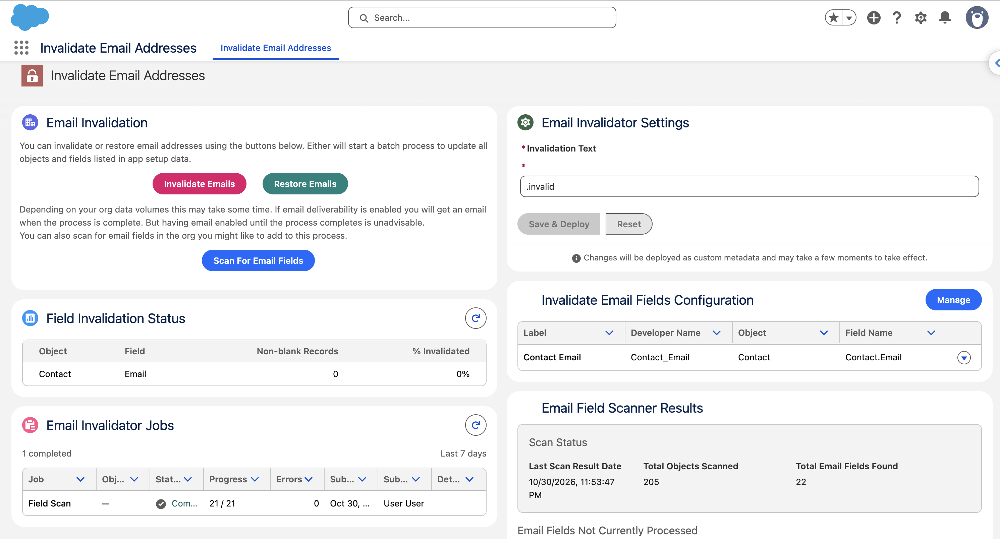

# Salesforce Email Invalidator

A simple tool to invalidate all the email addresses in your Salesforce org. This is meant to be used in Sandboxes to avoid accidentally sending email to everyone in the org (which comes up more than people expect).

Currently this tool consists of unpackaged metadata. At some point I'll work on getting it packaged, but this is still an early draft.

## Installation

Currently this project just uses loose metadata and is not packaged. To install it, you need to clone this repo, or download its content. Then using sf cli run: `sf project deploy start`

## Main App

The project provides an Invalid Email App which shows a list of the fields that are setup to be invalided, and a Lightening Web Component to initiate the process of adding `.invalid` to the end of all values in that field.

You can add Custom Metadata records to list all email fields on any object, so all emails can be disabled.

Email fields are limited to 80 characters, so the invalidated value is kept within the field's limit:

- If the invalidated value fits, `.invalid` is appended as usual.
- If the address is shorter than the limit but the invalidated value is not, the value is cut off at the limit (for example ending in `.inv`). These addresses can still be fully restored.
- If the address is already at the limit, the end of the address is removed to make room for the full `.invalid`. These addresses can NOT be fully restored.

You can find the app in the app switcher by searching for `Invalidate Email`.

### Job Status

The Email Invalidator Jobs card on the app page lists the invalidate, restore, and field scan batch jobs from the last 7 days, with their status, progress, and any errors. While jobs are queued or running the card refreshes itself every few seconds, and it stops once they have all finished. The object each job is processing is shown for jobs started from the page during your current visit.

### Field Invalidation Status

The Field Invalidation Status card lists each configured email field with the number of records that have a value in that field and the percentage of those values that currently end with the invalidation text. Each field is counted separately, so if one field can't be counted its row shows the error and the others still load. The card refreshes itself when an Email Invalidator job finishes.

## Permission Sets

Anyone you want to be able to use this process should be assigned the included Invalidate Emails permission set.

Users who only need to build or run flows that use the Invalidate All Configured Emails or Restore All Configured Emails flow actions can instead be assigned the Invalidation Flow Users permission set.

## Sandbox Post Copy Process

There is also a SandboxPostCopy class you can use to have the process run as soon as a Sandbox refresh or create completes. This is only useful in a full or partial copy sandbox.

When you create a sandbox there is a field that allows you to indicate classes you want run after the process completes. Enter `InvalidateEmailSandboxPostCopy` and the process defined here will run.

## Automated Testing

Every pull request to `main` runs two workflows: [Jest Tests](.github/workflows/jest.yml) runs the LWC Jest tests, and [Apex Tests](.github/workflows/apex.yml) runs the Apex tests. The Apex tests run in a new scratch org that is deleted when the run finishes.

The Apex job signs in to the project's Dev Hub using the JWT bearer flow and an External Client App, and needs these repository secrets:

- `SF_CONSUMER_KEY`: the External Client App's consumer key.
- `SF_JWT_KEY`: the private key matching the certificate uploaded to the External Client App.
- `SF_USERNAME`: the Dev Hub user the workflow signs in as.

## Planned Features

- Scan for Email Fields: It would be helpful to have a process that scans the org for email fields and adds custom metadata records for those fields to the system.
- Un-Invalidate Fields: Adding `.invalid` is helpful. It would also be nice to easily remove it again under some conditions.

Suggestions welcome. Please create a new [Issue](https://github.com/acrosman/SalesforceInvalidateEmail/issues) and submit your ideas.
